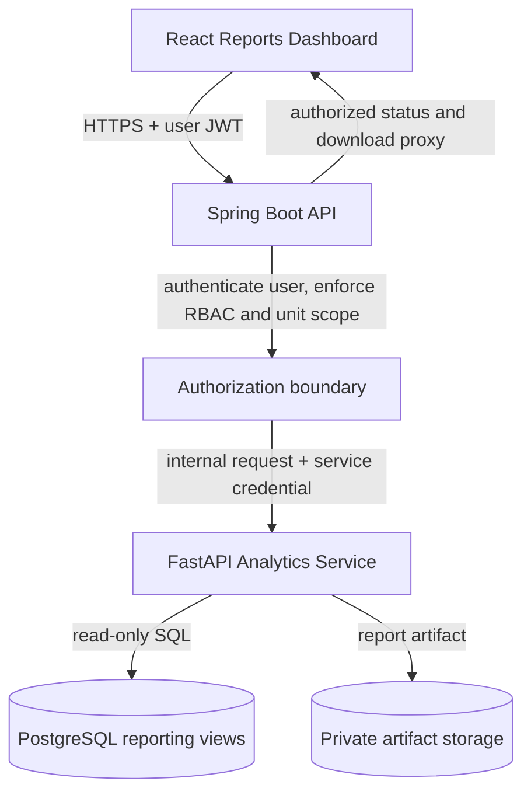

# Analytics Microservice — Architecture & Operations

**Status:** Proposed architecture; implementation and production deployment are not yet verified.  
**Repository:** `Ganeshkatam/Raghus_NSS`  
**Service boundary:** `analytics/` (Python)

## 1. Purpose and scope

The analytics component is intended to move CPU- and memory-intensive institutional aggregation and PDF compilation out of the transactional Spring Boot process. Spring Boot remains the public application API and the authority for user authentication, role-based access control, and unit-scope authorization. The analytics service is an internal worker/API, not a second public application backend.

The repository currently contains:
- `analytics/main.py`, an offline Python utility that accepts in-memory records.
- `analytics/requirements.txt`, the current Python utility dependency list.
- Spring Boot reporting functionality in `ReportService` and `ReportController`.
- Dashboard and CSV export functionality in `frontend/src/pages/Reports.tsx`.

Current Spring Boot reporting endpoints:
- `GET /api/v1/reports/metrics`
- `GET /api/v1/reports/export/volunteers`
- `GET /api/v1/reports/export/events`
- `GET /api/v1/reports/export/service-hours`

These remain the current application contract until an implementation change explicitly migrates an operation. Do not describe the FastAPI endpoints below as deployed or available until code and Render configuration have been merged and verified.

## 2. Target topology

### Responsibilities

| Component | Responsibility | Must not do |
|---|---|---|
| React frontend | Request reports through Spring Boot; display job state and download result | Call the private analytics service directly or hold its service credential |
| Spring Boot | Authenticate the user, authorize report capability and unit scope, validate request, submit jobs, expose status/download to the same authorized principal | Perform large Pandas aggregations or trust client-supplied unit scope |
| FastAPI analytics | Validate internal requests, query approved reporting views, aggregate data, generate artifacts, report job state | Authenticate end users independently, make business authorization decisions, or write to transactional tables |
| PostgreSQL | Remain the system of record; expose only approved reporting data to analytics | Give analytics owner, migration, or general application credentials |
| Artifact storage | Store generated files privately with bounded retention | Publish report objects through guessable public URLs |

## 3. Security and authorization model

1. **User authorization stays in Spring Boot.** Existing `REPORTS_VIEW` / `REPORTS_EXPORT` authorities and unit-manager scope must be checked before job submission and before status or download access.
2. **Never trust a unit ID supplied by the browser.** Spring Boot derives or validates permitted unit IDs from the authenticated principal and passes the effective scope in an authenticated internal request.
3. **Service-to-service authentication is separate from user authentication.** Use a high-entropy secret stored only in Render environment secrets; compare credentials in constant time, rotate them, and never log them.
4. **Private network is not authorization.** Use Render private networking where supported, avoid a public custom domain, and authenticate every internal request.
5. **Database least privilege.** Provision a dedicated PostgreSQL role with `LOGIN`, `CONNECT`, and `SELECT` only on explicitly granted reporting views (or narrowly scoped tables if views cannot meet query needs). Revoke default/public privileges. It must not own schemas, create objects, or mutate application data.
6. **Sensitive fields.** Exclude email, phone, emergency contacts, and other direct identifiers unless a specific report requires them and the requesting capability authorizes them.
7. **Input and resource limits.** Validate report type, date range, unit scope, and output format; cap date-span, row count, concurrent jobs, request size, execution time, and artifact size.
8. **Auditability.** Record requesting user ID, effective unit scope, report type, job ID, timestamps, outcome, and artifact checksum. Never record credentials or report contents in logs.

## 4. API contract — target, not yet deployed

All endpoints are internal and versioned under `/internal/api/v1`. They are not part of the public frontend API.

| Method and path | Purpose |
|---|---|
| `GET /internal/api/v1/health/live` | Process liveness without dependency details or secrets |
| `GET /internal/api/v1/health/ready` | Readiness including database connectivity |
| `POST /internal/api/v1/report-jobs` | Validate and enqueue a report; return `202 Accepted` and a job ID |
| `GET /internal/api/v1/report-jobs/{jobId}` | Return status and safe progress metadata |
| `GET /internal/api/v1/report-jobs/{jobId}/artifact` | Stream completed artifact to the authenticated Spring Boot caller |

A report request contains a constrained report type, ISO-8601 date boundaries, output format, and effective unit scope established by Spring Boot. Do not accept raw SQL, arbitrary table names, filesystem paths, or caller-selected storage URLs.

Job states: `QUEUED`, `RUNNING`, `SUCCEEDED`, `FAILED`, `EXPIRED`. State transitions are monotonic and terminal states immutable. Make submission idempotent with a caller-generated idempotency key scoped to the principal and request fingerprint.

Errors use a stable JSON envelope with machine-readable code, safe message, correlation ID, and retryability flag. Never return stack traces, SQL text, connection strings, or internal hostnames.

## 5. Data access and reporting semantics

- Define reviewed SQL views for volunteer/unit membership, events/registrations, attendance, and approved service-hour entries based on the actual Flyway schema.
- Approved service hours include only entries whose status is `APPROVED`; pending and rejected claims must not contribute to compliance totals.
- Define date semantics explicitly: UTC storage, institution timezone for calendar grouping, inclusive start and exclusive end boundaries.
- Avoid unbounded `SELECT *`; use named columns, parameterized queries, bounded pagination/batching, and database-side aggregation where practical.
- Add indexes only after inspecting actual query plans and representative data volumes.
- Use read-only transactions/sessions and statement timeouts for report queries.

The reporting role and views must be provisioned through a reviewed migration or controlled database administration procedure. Analytics must not reuse the Spring Boot application's database username/password.

## 6. Job execution, artifacts, and reliability

Use a bounded in-process worker only if expected concurrency and Render instance lifecycle make that safe. For durable jobs across restarts or multiple instances, use a persistent job store or managed queue; an in-memory task list is not durable.

- Enforce bounded worker and queue capacity; reject overload with `429` or `503` and a retry hint.
- Apply per-job deadlines, database statement timeouts, and cancellation checks.
- Store artifacts in private durable object storage when they must survive restarts or instance replacement; Render local filesystem storage is not durable.
- Use unpredictable artifact identifiers, verify job ownership in Spring Boot, and expire artifacts under a documented retention policy.
- Clean temporary files deterministically and enforce artifact size limits.
- Retry only transient failures with bounded exponential backoff and jitter.
- Keep report generation off request threads; browser polls Spring Boot for status and downloads only after authorization succeeds.

## 7. Render deployment contract

Create a separate Render service for `analytics/` (private service where available), with independent build/start commands, health checks, resource limits, and deploy lifecycle. Do not expose it through the frontend or a public route.

Required configuration is supplied through Render secrets/environment variables, not committed files:
- `ANALYTICS_DATABASE_URL`: dedicated read-only database connection string.
- `ANALYTICS_SERVICE_TOKEN`: internal service credential.
- `ARTIFACT_STORAGE_*`: private durable artifact storage configuration.
- `REPORT_MAX_DATE_RANGE_DAYS`, `REPORT_MAX_ROWS`, `REPORT_MAX_CONCURRENCY`, `REPORT_JOB_TIMEOUT_SECONDS`, and `ARTIFACT_RETENTION_DAYS`: validated resource controls.

Spring Boot receives only the internal analytics base URL and its caller credential. Do not put the analytics database URL in frontend configuration or pass the service credential to React.

Confirm actual Render service type, private hostname, port binding, and plan availability in the Render dashboard before documenting a deployed hostname. Do not invent a private URL.

## 8. Spring Boot integration contract

Implement a typed internal client with explicit timeouts, bounded connection pools and response sizes, server-side secret injection, DTO validation, correlation ID propagation, safe structured error mapping, and bounded retries only for idempotent transient operations. Use circuit-breaker or fail-fast behavior so report outages do not consume backend request capacity.

The public Spring Boot API remains the only browser-facing entry point. It authorizes the principal and unit scope, submits the internal job, correlates job ownership, and proxies artifact downloads only after re-checking authorization.

Keep current CSV endpoints operational during migration. Migrate one report type at a time and remove old implementations only after parity tests, authorization tests, monitoring, and rollback procedures are complete.

## 9. Verification and acceptance criteria

- Unit tests cover aggregation semantics, empty datasets, date boundaries, null values, duplicate records, and CSV/PDF validity.
- API tests cover missing/invalid credentials, malformed requests, oversized date ranges, unknown jobs, invalid state transitions, and overload responses.
- Database integration tests verify the analytics role can read approved views and cannot insert, update, delete, truncate, create, or alter objects.
- Spring Boot tests verify capability enforcement, cross-unit denial, principal/job ownership, timeout behavior, and safe error mapping.
- Contract tests verify Spring Boot and FastAPI DTO compatibility.
- Load tests measure report duration, peak memory, database load, queue saturation, and impact on QR attendance latency.
- Deployment checks verify private reachability, secret separation, health probes, restart behavior, artifact durability, and log redaction.

Production readiness requires these checks to pass in CI and a staging Render deployment to be exercised.

## 10. Rollout sequence

1. Freeze the existing public reporting API and capture representative output fixtures.
2. Inspect the authoritative Flyway schema and design read-only reporting views/role.
3. Implement FastAPI health, authentication, schemas, bounded job execution, and one report type.
4. Implement the Spring Boot internal client and job/status/download façade while preserving existing endpoints.
5. Compare output and authorization behavior against the existing implementation.
6. Add PDF generation, additional report types, artifact storage, metrics, and alerting.
7. Deploy analytics privately to Render staging; verify resource limits and failure behavior.
8. Enable production traffic gradually; retain the existing export path as rollback until parity and operational stability are demonstrated.
9. Update this document's status and deployment details only after code, tests, and Render configuration are verified.
